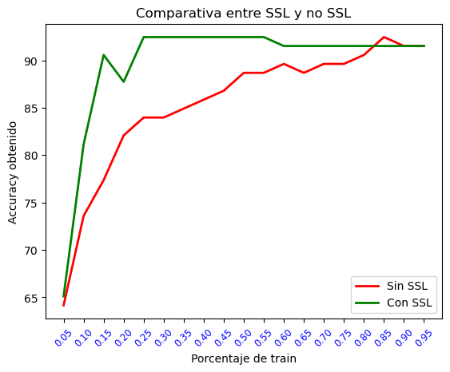
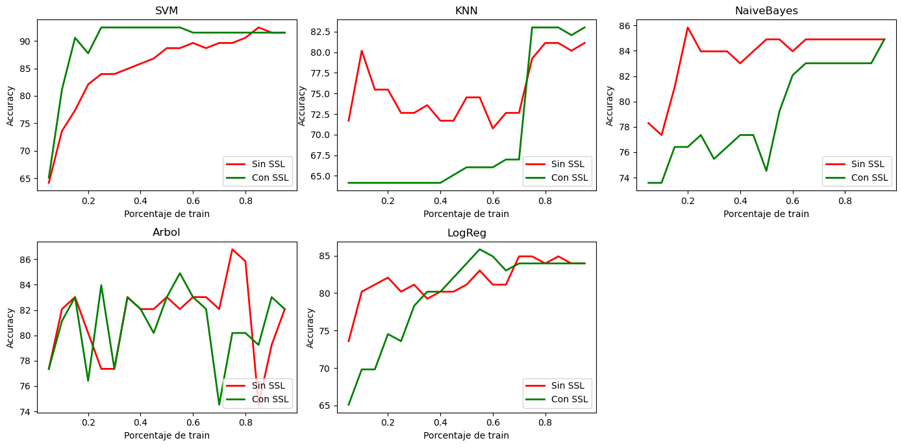

<!-- Danny Carrera -->

# Práctica de aprendizaje semi-supervisado: self-training

**Autor:** Danny Carrera
**Asignatura:** Computación Avanzada
**Notebook:** `SemiSupervisado.ipynb`

---

## 1. Objetivo

Implementar el algoritmo **self-training** para resolver un problema de aprendizaje semi-supervisado con la metodología *inductive learning*, usando el dataset **Ionosphere** y una máquina de soporte vectorial (SVM) como clasificador. Después, como estudio complementario, comprobar si el método funciona igual de bien en otros datasets y con otros clasificadores.

## 2. Archivos de la práctica

| Archivo | Contenido |
|---|---|
| `SemiSupervisado.ipynb` | Notebook con el desarrollo y las salidas de la práctica |
| `dataset.py` | Clase `dataset` y función `lecturaDatos` para leer ficheros `.dat` |
| `test_helper.py` | Clase `Test` con las comprobaciones (`assertEquals`) del profesor |
| `ionosphere.dat` | Dataset de la práctica |
| `datasetsP2/` | Datasets de la práctica 2, usados en el estudio complementario |
| `imagenes/` | Gráficas exportadas del notebook |

## 3. Dataset: Ionosphere

Un sistema de radar recoge información de 16 antenas para decidir si los electrones presentan algún tipo de estructura en la ionosfera (**Bueno**, `g`) o no (**Malo**, `b`). Una vez leído con `lecturaDatos`:

- **351 ejemplos** y **33 atributos** numéricos.
- **2 clases:** 225 ejemplos de una clase y 126 de la otra.

Más información en <https://archive.ics.uci.edu/ml/datasets/Ionosphere>.

La lectura se hace con la clase `dataset` proporcionada:

```python
ion, _ = ds.lecturaDatos("ionosphere.dat")
```

`ion.data` contiene los atributos y `ion.target` las clases codificadas como números.

---

## 4. Desarrollo de la práctica

### Paso 1. Partición hold-out estratificada

Divido el dataset en entrenamiento (70%) y test (30%) con `train_test_split`, con `stratify` sobre las etiquetas para mantener la proporción de clases y semilla 2.

```python
X_train, X_test, y_train, y_test = model_selection.train_test_split(
    ion.data, ion.target, test_size=0.3, random_state=2, stratify=ion.target)
```

Resultado: **245 ejemplos de entrenamiento** y **106 de test**. En el test, la clase mayoritaria representa el 64.15% (68 de 106 ejemplos), valor que sirve como referencia de un clasificador que siempre predice la misma clase.

### Paso 2. Aprendizaje supervisado de referencia

Creo una SVM con `probability=True` (necesario para `predict_proba` en self-training), `gamma='auto'` y `random_state=1`, la entreno con todo el entrenamiento y evalúo en test.

| Situación | Accuracy en test |
|---|---|
| Supervisado con los 245 ejemplos etiquetados | **89.62 %** (95 de 106) |

Test del profesor superado.

### Paso 3. Simulación del problema semi-supervisado

Aplico de nuevo `train_test_split`, pero solo sobre los datos de entrenamiento del paso 1, con estratificación y semilla 2. El 70% pasa a ser el conjunto **U** (sin etiquetas, sus clases se ignoran) y el 30% restante es el conjunto **L** (etiquetado).

```python
L, U, L_target, U_target = model_selection.train_test_split(
    X_train, y_train, test_size=0.7, random_state=2, stratify=y_train)
```

Resultado: `L` tiene **73 ejemplos** y `U` tiene **172**.

### Paso 4. Clasificador entrenado solo con L

Entreno la SVM únicamente con L y evalúo sobre el mismo `X_test` del paso 1, para que la comparación sea justa.

| Situación | Accuracy en test |
|---|---|
| Solo L (73 ejemplos), sin SSL | **83.96 %** |

Este es el valor de referencia que self-training debe intentar mejorar. Test del profesor superado.

### Paso 5. Algoritmo self-training (k = 1)

Mientras queden ejemplos en U, en cada iteración:

1. Entreno la SVM con L.
2. Calculo las probabilidades de cada clase para los ejemplos de U con `predict_proba`.
3. Ordeno esas probabilidades por filas con `np.sort`.
4. Obtengo los índices de ese orden con `np.argsort`; la última columna contiene la clase predicha.
5. Ordeno la última columna del paso 3 (la confianza de la predicción) para obtener los índices de los ejemplos.
6. Selecciono los `k` ejemplos de U con mayor confianza.
7. Los elimino de U con `np.delete(U, indices, 0)`.
8. Tomo las clases predichas para esos ejemplos.
9. Añado los ejemplos a L con `np.vstack`.
10. Añado las clases predichas a las de L con `np.hstack`.
11. Repito hasta que U queda vacío.

```python
k = 1
while U.shape[0] > 0:
    clf.fit(L, L_target)
    pr = clf.predict_proba(U)
    prAux = np.sort(pr, axis=1)
    clasesAux = np.argsort(pr, axis=1)
    indices = np.argsort(prAux[:, -1])
    ejemplos = U[indices[-k:]]
    clases = clasesAux[indices[-k:], -1]
    L = np.vstack((L, ejemplos))
    L_target = np.hstack((L_target, clases))
    U = np.delete(U, indices[-k:], 0)
```

Con k = 1 se hacen 172 iteraciones y L pasa de 73 a 245 ejemplos. Las etiquetas de los 172 ejemplos añadidos son predicciones de la SVM, nunca las reales (`U_target` no se usa). Se eligen primero los ejemplos con más confianza para reducir el riesgo de introducir etiquetas erróneas, que se propagarían a los entrenamientos siguientes. Test del profesor superado (últimas 10 etiquetas añadidas).

### Paso 6. Clasificador con el conjunto ampliado

Entreno la SVM con el L ampliado y evalúo en el mismo test.

| Situación | Accuracy en test |
|---|---|
| Supervisado con todo el train (paso 2) | 89.62 % |
| Solo L, sin SSL (paso 4) | 83.96 % |
| **L ampliado con self-training (paso 6)** | **92.45 %** (98 de 106) |

**¿Mejora respecto al paso 4? Sí:** sube 8.49 puntos porcentuales, equivalentes a 9 ejemplos de test más bien clasificados. Además supera al supervisado con todas las etiquetas reales, algo poco habitual que probablemente se debe al tamaño reducido del dataset y del test. Test del profesor superado.

### Paso 7. Variación del porcentaje de ejemplos etiquetados

Repito los pasos 3 a 6 para todos los porcentajes de U entre el 5% y el 95% con saltos del 5% (es decir, L va del 95% al 5% del entrenamiento) y guardo el accuracy con y sin SSL para dibujar la gráfica comparativa.



| % de train etiquetado (L) | Sin SSL | Con SSL |
|---|---|---|
| 95 | 91.51 | 91.51 |
| 90 | 91.51 | 91.51 |
| 85 | 92.45 | 91.51 |
| 80 | 90.57 | 91.51 |
| 75 | 89.62 | 91.51 |
| 70 | 89.62 | 91.51 |
| 65 | 88.68 | 91.51 |
| 60 | 89.62 | 91.51 |
| 55 | 88.68 | 92.45 |
| 50 | 88.68 | 92.45 |
| 45 | 86.79 | 92.45 |
| 40 | 85.85 | 92.45 |
| 35 | 84.91 | 92.45 |
| 30 | 83.96 | 92.45 |
| 25 | 83.96 | 92.45 |
| 20 | 82.08 | 87.74 |
| 15 | 77.36 | 90.57 |
| 10 | 73.58 | 81.13 |
| 5 | 64.15 | 65.09 |

Los dos tests del profesor (vectores `sinSSL` y `conSSL`) se superan.

**Interpretación de la gráfica:**

- **Con muchos etiquetados (80% a 95%):** las dos curvas coinciden o casi (en torno al 91.5%). Queda poca información en U que aportar.
- **Con una cantidad moderada (25% a 55%):** es donde SSL funciona mejor. Se mantiene estable en 92.45% mientras que sin SSL baja de forma progresiva hasta el 83.96%.
- **Mejor caso:** con el 15% de train, SSL mejora 13.21 puntos (90.57% frente a 77.36%).
- **Con muy pocos (5%):** casi no hay mejora (65.09% frente a 64.15%), porque con unos 12 ejemplos las primeras predicciones son poco fiables y los errores se propagan. El 64.15% coincide con la proporción de la clase mayoritaria en test.
- **Caída puntual al 20%:** SSL baja a 87.74%, probablemente por la propagación de algunas etiquetas erróneas en esa partición concreta.

---

## 5. Estudio complementario

El enunciado pide probar el método en otros datasets y con otros clasificadores.

### 5.1. Metodología

Para ello encapsulo el experimento en funciones reutilizables:

- `selfTraining(clf, L, L_target, U, k)`: el mismo algoritmo del paso 5 para cualquier clasificador. Usa `clf.classes_` para traducir la columna elegida a la etiqueta real, lo que permite datasets cuyas clases no empiezan en 0.
- `estudio(fichero, clf, k, escalar)`: lee un dataset con `lecturaDatos`, hace el hold-out 70/30 estratificado (semilla 2), escala los atributos con `StandardScaler` ajustado solo con el entrenamiento, y repite el paso 7 devolviendo los accuracy con y sin SSL.
- `estudioXY(...)`: igual que `estudio`, pero partiendo de los datos ya particionados del paso 1, para evaluar Ionosphere (sin escalar, como en el resto de la práctica) con el mismo test.
- `resumen(...)`: muestra el accuracy medio sin y con SSL, la diferencia media y en cuántos porcentajes mejora, empata o empeora.

**Criterio:** considero que SSL *funciona* si la diferencia media (con SSL menos sin SSL) es positiva y mejora en más porcentajes de los que empeora.

**Decisiones tomadas:**

- Los atributos de los datasets nuevos se escalan, porque la SVM con `gamma='auto'` degenera cuando los atributos tienen escalas muy distintas. Por ejemplo, en `pima` sin escalar el resultado queda constante en 64.94%, que es la proporción de la clase mayoritaria, tanto con SSL como sin él. Ionosphere no necesita escalado porque sus atributos ya están entre -1 y 1.
- Se descartan `ecoli` (una clase con solo 2 ejemplos, no permite estratificar con porcentajes pequeños), `page-blocks` (5472 ejemplos) y `yeast` (1484 ejemplos y 10 clases), por el coste de reentrenar en cada iteración con k = 1.

### 5.2. Otros datasets (SVM)

Se usan los datasets de la práctica 2 con la misma SVM. Media de los 19 porcentajes:

| Dataset | Sin SSL | Con SSL | Diferencia | Mejora / empata / empeora | Resultado |
|---|---|---|---|---|---|
| appendicitis | 89.97 | 89.64 | -0.33 | 6 / 9 / 4 | no funciona |
| balance | 88.19 | 85.83 | -2.35 | 1 / 4 / 14 | no funciona |
| bupa | 63.66 | 62.50 | -1.16 | 6 / 2 / 11 | no funciona |
| glass | 60.73 | 58.14 | -2.59 | 5 / 2 / 12 | no funciona |
| haberman | 74.26 | 74.14 | -0.11 | 7 / 7 / 5 | no funciona |
| iris | 95.44 | 87.95 | -7.49 | 0 / 0 / 19 | no funciona |
| newthyroid | 94.57 | 93.68 | -0.89 | 4 / 8 / 7 | no funciona |
| pima | 75.51 | 75.67 | +0.16 | 10 / 1 / 8 | funciona (marginal) |
| wine | 98.83 | 95.32 | -3.51 | 0 / 14 / 5 | no funciona |
| wisconsin | 97.10 | 96.97 | -0.13 | 2 / 10 / 7 | no funciona |
| **Ionosphere** (práctica) | 85.45 | 89.67 | **+4.22** | 16 / 2 / 1 | **funciona** |

En `pima` el criterio da "funciona", pero la diferencia (+0.16 puntos) es menor que el valor de un solo ejemplo de test (0.43 puntos), por lo que debe considerarse marginal. **Ionosphere es el único caso con una mejora clara.**

### 5.3. Otros clasificadores

Se comparan la SVM, K vecinos más cercanos (KNN, 5 vecinos), Naive Bayes gaussiano, árbol de decisión y regresión logística. Todos disponen de `predict_proba`, necesario para elegir los ejemplos con más confianza.

**Ionosphere** (sin escalar):

| Clasificador | Sin SSL | Con SSL | Diferencia | Mejora / empata / empeora | Resultado |
|---|---|---|---|---|---|
| SVM | 85.45 | 89.67 | **+4.22** | 16 / 2 / 1 | funciona |
| KNN | 75.42 | 69.71 | -5.71 | 5 / 0 / 14 | no funciona |
| Naive Bayes | 83.66 | 79.10 | -4.57 | 0 / 1 / 18 | no funciona |
| Árbol de decisión | 81.38 | 80.88 | -0.50 | 4 / 8 / 7 | no funciona |
| Regresión logística | 81.63 | 79.74 | -1.89 | 6 / 4 / 9 | no funciona |



**pima** (escalado):

| Clasificador | Sin SSL | Con SSL | Diferencia | Mejora / empata / empeora | Resultado |
|---|---|---|---|---|---|
| SVM | 75.51 | 75.67 | +0.16 | 10 / 1 / 8 | funciona (marginal) |
| KNN | 75.32 | 71.88 | -3.44 | 2 / 0 / 17 | no funciona |
| Naive Bayes | 73.59 | 70.90 | -2.69 | 1 / 0 / 18 | no funciona |
| Árbol de decisión | 69.54 | 69.61 | +0.07 | 8 / 0 / 11 | no funciona |
| Regresión logística | 75.35 | 76.03 | **+0.68** | 13 / 2 / 4 | funciona |

**haberman** (escalado): SSL no funciona con ningún clasificador (diferencias entre -0.11 y -2.23).

**Observaciones sobre los clasificadores:**

- Solo la SVM se beneficia claramente en Ionosphere. En pima, la regresión logística es el caso más sólido (+0.68, mejora en 13 de 19).
- **KNN con SSL en Ionosphere:** con pocos etiquetados el accuracy se queda fijo en 64.15%, el porcentaje de la clase mayoritaria en test, es decir, el clasificador acaba prediciendo siempre la misma clase. Solo mejora ligeramente con más del 75% de train.
- **Interpretación (hipótesis no contrastada con pruebas específicas):** self-training necesita que `predict_proba` dé una confianza fiable. KNN con 5 vecinos produce probabilidades en saltos de 0.2 con muchos empates; Naive Bayes suele ser excesivamente seguro de sí mismo; y el árbol de decisión sin límite de profundidad da probabilidades casi siempre de 0 o 1, de modo que la confianza no permite distinguir qué ejemplos añadir. La SVM (con `probability=True`) y la regresión logística ofrecen probabilidades más ajustadas.

---

## 6. Conclusiones

1. **Self-training funciona en Ionosphere con la SVM.** Con el 30% de etiquetas pasa de 83.96% a 92.45%, e incluso supera al supervisado con todas las etiquetas (89.62%). En el barrido de todos los porcentajes mejora de media 4.22 puntos y gana en 16 de 19 casos.
2. **El beneficio depende de la cantidad de etiquetas.** Es nulo con muchas (más del 80% de train, queda poco que aprender de U) y casi nulo con muy pocas (5%, las primeras predicciones son poco fiables y los errores se propagan). Es máximo con cantidades moderadas.
3. **No es una mejora garantizada en otros datasets.** De los 10 datasets probados con la SVM, solo pima sale positivo y de forma marginal. En el resto el resultado es neutro o peor, con los casos más negativos en iris (-7.49), wine (-3.51), glass (-2.59) y balance (-2.35). Interpreto que influyen un acierto inicial ya muy alto (wine, wisconsin, iris), clases muy solapadas (bupa, haberman, pima) y pocos ejemplos con varias clases (glass, iris, wine); esta explicación no ha sido contrastada con pruebas específicas.
4. **El resultado depende del clasificador.** SVM funciona en Ionosphere; KNN y Naive Bayes empeoran claramente y el árbol y la regresión logística no mejoran. Cuando los errores de las primeras etiquetas asignadas se propagan, el método puede empeorar el resultado respecto a no usar datos sin etiquetar.
5. **Conclusión general:** self-training puede mejorar de forma notable el rendimiento cuando hay pocos datos etiquetados, pero depende del clasificador (probabilidades fiables), del dataset (acierto inicial, separabilidad de las clases, ejemplos por clase) y de la cantidad de etiquetas disponibles.

### Limitaciones

- Todos los resultados proceden de **una única partición con semilla fija** y conjuntos de test pequeños. Un ejemplo de test equivale a entre 0.4 y 3 puntos de accuracy según el dataset, por lo que las diferencias pequeñas (por ejemplo, +0.16 en pima) no son concluyentes. Para afirmarlo con más rigor habría que repetir los experimentos con varias semillas o con validación cruzada.
- En los datasets nuevos se escalaron los atributos y en Ionosphere no, igual que en el resto de la práctica.
- Se usó siempre `k = 1`, y solo se probaron los hiperparámetros por defecto de cada clasificador (salvo los que pide el enunciado para la SVM).
- Se descartaron ecoli, page-blocks y yeast.

---

## 7. Cumplimiento de objetivos e indicaciones

| Indicación | Cumplida | Evidencia |
|---|---|---|
| Leer `ionosphere.dat` con `lecturaDatos` y guardarlo en `ion` | Sí | Celda de lectura |
| Paso 1: hold-out estratificado, 30% test, semilla 2 | Sí | 245 train y 106 test |
| Paso 2: SVM (`probability=True`, `gamma='auto'`, `random_state=1`) y accuracy | Sí | 89.62 %; test superado |
| Paso 3: partición de train en L y U (70% a U), semilla 2 | Sí | L = 73, U = 172 |
| Paso 4: SVM con L y accuracy en test | Sí | 83.96 %; test superado |
| Paso 5: self-training en las 11 etapas con k = 1 | Sí | Test de las últimas 10 etiquetas superado |
| Paso 6: SVM con el L ampliado y comparación con el paso 4 | Sí | 92.45 %, mejora de 8.49 puntos; test superado |
| Paso 7: bucle del 5% al 95%, almacenar resultados y gráfica comparativa | Sí | Dos tests superados y gráfica |
| Estudio complementario: probar otros datasets | Sí | 10 datasets con la SVM |
| Estudio complementario: probar otros clasificadores | Sí | 5 clasificadores en Ionosphere, pima y haberman |

**Valoración:** se han cumplido todas las indicaciones de la práctica, y los seis tests del profesor se superan. El estudio complementario está completo. La evidencia es de una sola partición, por lo que las conclusiones sobre los datasets y clasificadores deben leerse con la cautela indicada en las limitaciones.

---

## 8. Cómo reproducir

Requisitos: Python 3 con `numpy`, `matplotlib`, `scikit-learn` y `jupyter`.

```bash
pip install numpy matplotlib scikit-learn jupyter
jupyter notebook SemiSupervisado.ipynb
```

Ejecuta las celdas en orden. Las celdas del estudio complementario con k = 1 tardan unos minutos, sobre todo el dataset `pima`.
